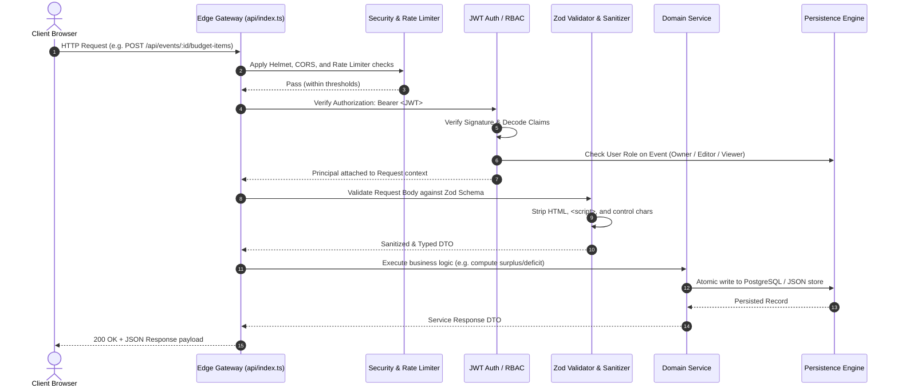

# 🏛️ EventPilot System Architecture & Domain Design

This document details the architectural topology, service boundaries, data model ownership, validation pipeline, and AI orchestration design for **EventPilot**.

---

## 1. System Topology Overview

EventPilot is architected as a clean TypeScript monorepo with strict separation of concerns across client, server, and serverless edge layers:

```
[ Client Workspace (React 19 + Tailwind CSS v4) ]
                     │  HTTP / HTTPS / SSE
                     ▼
[ Edge Gateway / Vercel Serverless Function (api/index.ts) ]
                     │  Express 5 Pipeline
                     ▼
┌─────────────────────────────────────────────────────────────┐
│                      Express 5 Server                       │
│                                                             │
│  [ Middleware Pipeline ]                                    │
│   ├── Helmet Security Headers (CSP, HSTS, X-Frame-Options)   │
│   ├── CORS Whitelist Validation                             │
│   ├── 1MB Payload Limiter (DoS prevention)                  │
│   ├── XSS & Control Character Sanitizer                     │
│   ├── Per-IP Rate Limiting (express-rate-limit)             │
│   ├── JWT Auth & Role-Based Access Control (RBAC)           │
│   └── Request ID Correlation & Context Logger               │
│                                                             │
│  [ Domain Routing Layer ]                                   │
│   ├── /api/auth          (Register, Login, Session)         │
│   ├── /api/events        (CRUD, Metrics, Budget, Tasks)     │
│   ├── /api/collaborators (Invite, Update Role, Revoke)      │
│   └── /api/metrics       (Uptime, Memory RSS/Heap, Health)  │
│                                                             │
│  [ Business Logic & Orchestration Services ]               │
│   ├── Deterministic Financial Engine (Exact Integer Math)   │
│   ├── Budget Rescue Mode™ (Algorithmic Deficit Resolution)  │
│   ├── Dual-Layer AI Orchestrator (Gemini 2.5 + Fallback)    │
│   ├── Asynchronous TaskQueue (Concurrency Controlled)       │
│   └── Tamper-Evident Audit Trail & Activity Logger          │
│                                                             │
│  [ Dual-Storage Persistence Layer ]                         │
│   ├── PostgreSQL Connection Pool (pg.Pool)                  │
│   └── In-Memory / File-Backed Fallback Store                │
└─────────────────────────────────────────────────────────────┘
```

---

## 2. End-to-End Request Lifecycle



---

## 3. Service Boundaries & Domain Isolation

### A. Authentication & Access Control Service (`server/src/middleware/auth.ts`, `server/src/middleware/rbac.ts`)
- **Responsibility**: Authenticates users via cryptographic JWT tokens (PBKDF2 password derivation).
- **Enforcement**: Granular Role-Based Access Control (RBAC):
  - **Owner**: Full administrative rights (delete event, manage billing, invite/revoke collaborators).
  - **Editor**: Operational planning rights (create/update/delete budget items, tasks, vendors).
  - **Viewer**: Read-only dashboard access.
- **Cross-Tenant Isolation**: Every database query explicitly checks ownership or verified collaborator membership.

### B. Deterministic Financial Engine (`server/src/ai/planner.ts`, `client/src/utils/format.ts`)
- **Responsibility**: Authoritatively calculates all financial totals, remaining balances, and category allocations.
- **Guarantee**: Financial figures are **never** left to generative LLM calculations. LLMs propose creative items; backend code computes exact sums with zero rounding errors.

### C. Budget Rescue Mode™ Engine (`server/src/ai/planner.ts`, `client/src/components/BudgetRescueModal.tsx`)
- **Responsibility**: Detects financial deficits when line items exceed target event budgets.
- **Execution Algorithm**:
  1. Computes total deficit: `deficit = currentTotalEstimated - targetBudget`.
  2. Evaluates non-negotiable priority areas (e.g. Venue, Catering) specified by the organizer.
  3. Sorts elastic categories (e.g. Decor, Entertainment, Favors) by savings potential.
  4. Generates granular trade-off options with exact financial savings.
  5. Enforces **Human-in-the-Loop Consent**: Changes are applied only after the user selectively marks approval checkboxes.

### D. AI Orchestration & Safety Guardrails (`server/src/ai/guardrails.ts`, `server/src/ai/planner.ts`)
- **Responsibility**: Manages conversational copilot interactions and event plan synthesis.
- **Safety Pipeline**:
  1. **Input Guardrail**: Inspects prompts against 10 adversarial vectors (system prompt extraction, delimiter evasion, credential harvesting, roleplay jailbreaks).
  2. **Confidence Scoring**: Evaluates risk score; blocks or flags unsafe inputs.
  3. **Deterministic Fallback**: If external LLM API is unavailable, throttled, or unconfigured, the system autonomously activates domain heuristics to generate comprehensive, culturally sound event plans across all 6 event archetypes.

### E. Asynchronous Task Queue (`server/src/services/taskQueue.ts`)
- **Responsibility**: Offloads CPU-intensive operations (AI plan generation, comprehensive audit report compilation) from the main HTTP event loop.
- **Features**: Max concurrency control, exponential backoff retries, and task lifecycle status tracking.

---

## 4. Validation & Sanitization Pipeline

Input validation is enforced symmetrically across the stack:

| Layer | Technology | Rules Enforced |
| :--- | :--- | :--- |
| **Client** | Form validation & `useDebounce` | Instant client feedback, character limits, numeric formatting |
| **API Boundary** | Zod Schemas (`server/src/schemas/`) | Strict types, regex dates (`YYYY-MM-DD`), non-negative numbers, enum whitelist |
| **Sanitizer** | `server/src/utils/sanitize.ts` | Strips `<script>`, `<style>`, `javascript:`, `data:`, non-printable control characters |
| **Database** | SQL DDL & Check Constraints | Primary/Foreign key integrity, cascading deletes, unique constraints |

---

## 5. Standardized Error Handling Architecture

All API endpoints return errors conforming to the standardized `ApiError` contract:

```typescript
interface ApiErrorResponse {
  error: string;
  statusCode: number;
  details?: unknown;
  timestamp: string;
  requestId?: string;
}
```

### Error Class Hierarchy (`server/src/utils/errors.ts`)
```
Error
 └── AppError (Base application error with HTTP status code)
      ├── ValidationError      (400 - Invalid request payload or Zod failure)
      ├── AuthenticationError   (401 - Missing, malformed, or expired token)
      ├── ForbiddenError        (403 - Insufficient RBAC privileges)
      ├── NotFoundError         (404 - Requested resource does not exist)
      ├── ConflictError         (409 - Resource already exists, e.g. email)
      └── RateLimitError        (429 - IP request limit exceeded)
```

---

## 6. Data Model Ownership & Dual-Storage Architecture

```
Events (1) ───< Budget Items (N)
Events (1) ───< Tasks / Milestones (N)
Events (1) ───< Vendors / Quotes (N)
Events (1) ───< Collaborators (N)
Events (1) ───< Audit Trail Logs (N)
```

- **Primary Store**: PostgreSQL with connection pooling (`pg.Pool`) and zero-downtime schema migrations (`server/src/database/migrator.ts`).
- **Resilient Fallback**: Thread-safe in-memory store backed by atomic file-based persistence (`server/data/database.json`), ensuring zero crashes in offline or zero-configuration development environments.
