# EventPilot Production Observability & Telemetry Reference

## 1. Monitoring & Observability Architecture

EventPilot provides full-stack telemetry and performance metrics for production operations.

```mermaid
flowchart LR
    ClientReq["Incoming HTTP Request"] --> TraceID["Attach X-Request-Id Correlation Header"]
    TraceID --> RateLimit["Token-Bucket Rate Limiter"]
    RateLimit --> AuditLog["Audit Logger (actor, action, resource, ip)"]
    AuditLog --> RouteHandler["Express API Controller"]
    RouteHandler --> Metrics["Telemetry Collector (uptime, heap, error rate)"]
    Metrics --> ClientResponse["JSON Response with X-Response-Time"]
```



---

## 2. Real-Time Telemetry Endpoint (`GET /api/metrics`)

Returns real-time system performance, heap memory breakdown, and AI cost optimization metrics:

```json
{
  "timestamp": "2026-10-20T22:50:00.000Z",
  "status": "operational",
  "uptime": {
    "seconds": 1845,
    "formatted": "0h 30m 45s"
  },
  "performance": {
    "totalRequestsServed": 1420,
    "errorCount": 0,
    "errorRate": "0.00%"
  },
  "memory": {
    "rssMB": "54.12",
    "heapTotalMB": "32.40",
    "heapUsedMB": "22.80"
  },
  "aiOptimization": {
    "totalRequests": 18,
    "cacheHits": 12,
    "cacheHitRatio": "66.7%",
    "promptInjectionsBlocked": 2,
    "estimatedTokensSaved": 28800,
    "costSavedUSD": 0.0576
  },
  "storage": {
    "databaseType": "Local Persistent JSON Engine",
    "activeEvents": 24
  }
}
```

---

## 3. Request Tracing & Correlation Headers
Every incoming HTTP request receives or inherits:
* `X-Request-Id`: Universally unique trace identifier (UUID v4) propagated across database logs and error handlers.
* `X-Response-Time`: Exact microsecond response duration recorded by Express timing middleware.
* `Strict-Transport-Security`: Enforces 1-year HSTS policy with `preload` and `includeSubDomains`.
